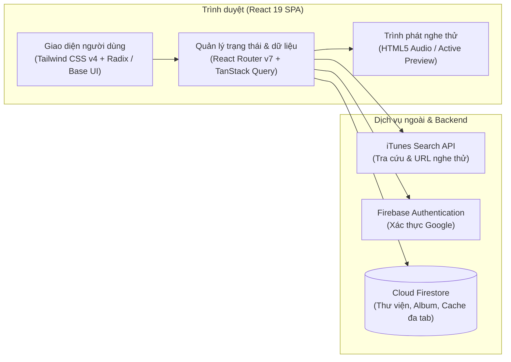

<div align="center">
  

# MusiMOB

_Sổ tay âm nhạc cá nhân: tra cứu, lưu trữ và nghe thử bài hát trên web_

[](https://react.dev/)
[](https://www.typescriptlang.org/)
[](https://vite.dev/)
[](https://tailwindcss.com/)
[](https://firebase.google.com/)
[](LICENSE)

</div>

---

## Tổng quan

**MusiMOB** là ứng dụng web quản lý và lưu trữ thông tin bài hát cá nhân. Ứng dụng tích hợp nguồn tra cứu iTunes Search API để tìm kiếm bản nhạc kho ngoài, hỗ trợ nghe thử trực tiếp đoạn trích âm thanh (Audio Preview) 30 giây, phân loại bài hát theo Album và đồng bộ dữ liệu thời gian thực qua Cloud Firestore có hỗ trợ bộ nhớ đệm đa tab.

## Mục lục

- [Tính năng chính](#tính-năng-chính)
- [Kiến trúc hệ thống](#kiến-trúc-hệ-thống)
- [Công nghệ sử dụng](#công-nghệ-sử-dụng)
- [Bắt đầu nhanh](#bắt-đầu-nhanh)
- [Cấu hình môi trường](#cấu-hình-môi-trường)
- [Lệnh khả dụng](#lệnh-khả-dụng)
- [Cấu trúc thư mục](#cấu-trúc-thư-mục)
- [Giấy phép](#giấy-phép)

## Tính năng chính

- **Thư viện bài hát cá nhân**: Quản lý danh sách bài hát đã lưu; lọc tức thì theo tên bài hát hoặc nghệ sĩ; hỗ trợ chuyển đổi chế độ xem lưới hoặc danh sách cùng thanh điều hướng thích ứng.
- **Trình phát nghe thử (Audio Preview)**: Phát đoạn trích âm thanh 30 giây trực tiếp trên web; kiểm soát trạng thái Đang nghe thử (Active Preview) để đảm bảo chỉ có duy nhất một bài phát tại một thời điểm.
- **Tra cứu và lưu bài**: Tìm kiếm bản nhạc từ iTunes Search API hoặc nhập thủ công; tự động kiểm tra bài đã có trong Thư viện để ngăn lưu trùng lặp.
- **Quản lý Album**: Gom nhóm bài hát theo chủ đề; hỗ trợ chọn nhiều bài hát (bulk selection) để thêm vào hoặc gỡ khỏi Album.
- **Xóa và khôi phục**: Gỡ bỏ bài hát khỏi Thư viện kèm thông báo thông tin với nút hoàn tác (Undo) khôi phục bài ngay lập tức.
- **Xác thực người dùng**: Đăng nhập qua tài khoản Google với Firebase Authentication; phân lập dữ liệu Thư viện và Album theo từng người dùng.
- **Bộ nhớ đệm ngoại tuyến**: Cấu hình `persistentLocalCache` và quản lý đa tab (`persistentMultipleTabManager`) trên Cloud Firestore, duy trì trạng thái dữ liệu khi chuyển tab hoặc mất kết nối tạm thời.
- **Giao diện sáng / tối**: Chuyển đổi linh hoạt giữa giao diện Sáng (Light), Tối (Dark) hoặc tự động theo cấu hình hệ điều hành.

## Kiến trúc hệ thống



## Công nghệ sử dụng

- **Frontend core**: React 19, TypeScript 5.9, Vite 8, Tailwind CSS v4.
- **Định tuyến & Dữ liệu**: React Router v7, TanStack React Query v5.
- **Thành phần giao diện**: Radix UI, Base UI, Lucide React, Sonner (toast), Vaul (drawer), CMDK.
- **Backend & Lưu trữ**: Firebase Authentication (Google Auth), Cloud Firestore (Persistent Cache), Firebase Hosting.
- **Nguồn dữ liệu ngoài**: iTunes Search API.

## Bắt đầu nhanh

### Yêu cầu môi trường

- Node.js >= 20.x (khuyến nghị Node.js 22.x theo môi trường CI)
- npm >= 10.x

### Cài đặt và khởi chạy

```bash
# 1. Sao chép kho mã nguồn
git clone https://github.com/dexter826/musimob.git
cd musimob

# 2. Cài đặt các gói phụ thuộc
npm install

# 3. Tạo tệp cấu hình môi trường cục bộ
cp .env.example .env.local

# 4. Khởi chạy máy chủ phát triển
npm run dev
```

Mở trình duyệt và truy cập tại [http://localhost:5173](http://localhost:5173).

## Cấu hình môi trường

Khai báo các thông số kết nối Firebase trong tệp `.env.local` (tham chiếu theo `.env.example`):

| Biến môi trường             | Bắt buộc | Mặc định / Giá trị mẫu | Mục đích                           |
| :-------------------------- | :------: | :--------------------: | :--------------------------------- |
| `VITE_FIREBASE_API_KEY`     |    Có    |           -            | Khóa Web API của Firebase          |
| `VITE_FIREBASE_AUTH_DOMAIN` |    Có    |           -            | Tên miền xác thực Firebase         |
| `VITE_FIREBASE_PROJECT_ID`  |    Có    |       `musi-mob`       | Mã định danh dự án Firebase        |
| `VITE_FIREBASE_APP_ID`      |    Có    |           -            | Mã định danh ứng dụng web Firebase |

## Lệnh khả dụng

| Lệnh                   | Mục đích                                                             |
| :--------------------- | :------------------------------------------------------------------- |
| `npm run dev`          | Khởi chạy máy chủ phát triển cục bộ với Vite HMR                     |
| `npm run build`        | Kiểm tra kiểu TypeScript (`tsc -b`) và đóng gói mã nguồn vào `dist/` |
| `npm run preview`      | Khởi chạy máy chủ xem trước bản đóng gói từ `dist/`                  |
| `npm run lint`         | Kiểm tra lỗi cú pháp và quy chuẩn mã nguồn với ESLint                |
| `npm run format`       | Tự động định dạng mã nguồn theo quy chuẩn Prettier                   |
| `npm run format:check` | Kiểm tra sự tuân thủ định dạng mã nguồn của Prettier                 |

## Cấu trúc thư mục

```text
src/
├── app/              # Cấu hình router, layout chính và các trang ứng dụng
├── components/       # Thành phần giao diện dùng chung và UI primitives
│   └── ui/           # Thành phần UI nguyên tử (Radix UI, Base UI)
├── features/         # Các module nghiệp vụ theo chức năng
│   ├── add-song/     # Biểu mẫu và tác vụ thêm bài hát thủ công
│   ├── albums/       # Quản lý album và liên kết bài hát
│   ├── auth/         # Đăng nhập, đăng xuất và quản lý phiên người dùng
│   ├── search-song/  # Tìm kiếm bản nhạc từ kho iTunes
│   └── songs/        # Hiển thị danh sách, lọc và thao tác với bài hát
├── hooks/            # Custom React hooks (tiêu đề, responsive, cuộn trang)
└── lib/              # Khởi tạo Firebase SDK, kết nối iTunes API và tiện ích
```

## Giấy phép

Dự án được phân phối theo giấy phép [MIT](LICENSE). Bản quyền © 2026 dexter826.
