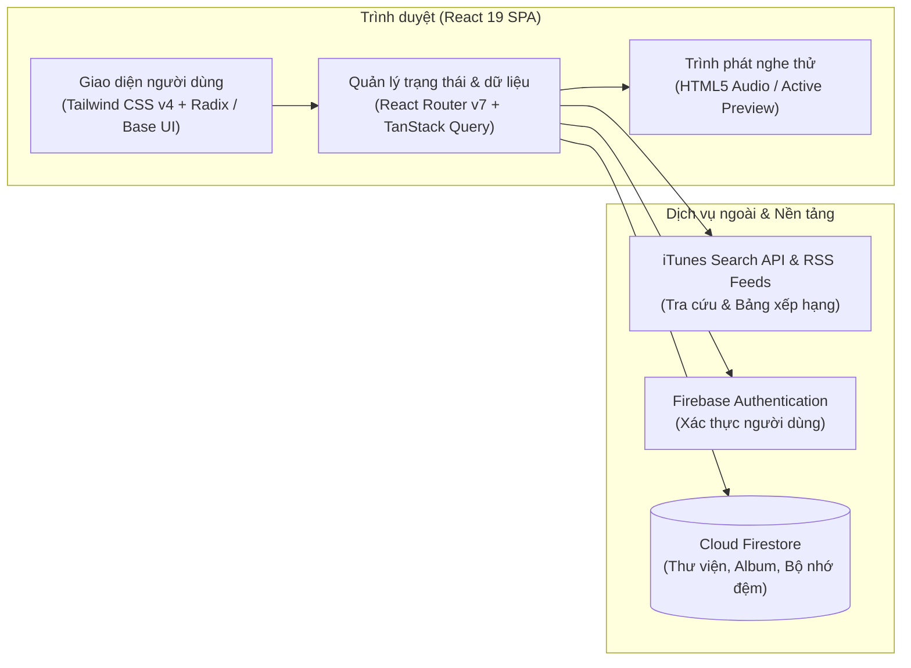

<div align="center">
  

# MusiMOB

_Sổ tay âm nhạc cá nhân: tra cứu, lưu trữ và nghe thử bài hát trên web_

[](https://react.dev/)
[](https://www.typescriptlang.org/)
[](https://vite.dev/)
[](https://tailwindcss.com/)
[](https://firebase.google.com/)
[](LICENSE)

</div>

---

## Tổng quan

**MusiMOB** là ứng dụng sổ tay âm nhạc cá nhân chạy trên trình duyệt web, giúp người dùng tra cứu thông tin bài hát, lưu trữ vào Thư viện riêng tư, gom nhóm theo Album và nghe thử đoạn trích âm thanh 30 giây. Dữ liệu được quản lý và đồng bộ theo từng tài khoản người dùng, đồng thời hỗ trợ sử dụng ngay cả khi gián đoạn kết nối mạng.

## Mục lục

- [Tính năng chính](#tính-năng-chính)
- [Kiến trúc hệ thống](#kiến-trúc-hệ-thống)
- [Công nghệ sử dụng](#công-nghệ-sử-dụng)
- [Bắt đầu nhanh](#bắt-đầu-nhanh)
- [Cấu hình môi trường](#cấu-hình-môi-trường)
- [Lệnh khả dụng](#lệnh-khả-dụng)
- [Cấu trúc thư mục](#cấu-trúc-thư-mục)
- [Giấy phép](#giấy-phép)

## Tính năng chính

- **Thư viện bài hát cá nhân**: Lưu trữ danh sách bài hát yêu thích; lọc tức thì theo tên bài hát hoặc nghệ sĩ; chuyển đổi linh hoạt giữa chế độ xem lưới và danh sách.
- **Khám phá bài hát**: Duyệt ngẫu nhiên 24 bài hát từ các bảng xếp hạng và nghệ sĩ trong Thư viện cá nhân; tự động loại trừ bài đã lưu; hỗ trợ làm mới danh sách hoặc lưu bài tức thì kèm cơ chế tự động bù bài tại chỗ.
- **Nghe thử âm thanh (Audio Preview)**: Phát đoạn trích âm thanh 30 giây trực tiếp trong ứng dụng; kiểm soát trạng thái để đảm bảo chỉ phát duy nhất một bài tại một thời điểm trên toàn hệ thống.
- **Tra cứu và thêm bài**: Tìm kiếm bài hát từ kho trực tuyến hoặc tự nhập thông tin thủ công; tự động cảnh báo nếu bài hát đã có trong Thư viện để tránh lưu trùng lặp.
- **Quản lý Album**: Gom nhóm các bài hát đã lưu theo chủ đề; hỗ trợ chọn nhiều bài cùng lúc để thêm vào hoặc bỏ khỏi album.
- **Xóa và khôi phục**: Gỡ bài hát khỏi Thư viện kèm thông báo hoàn tác (Undo), cho phép khôi phục nguyên vẹn dữ liệu ngay sau khi xóa.
- **Tài khoản người dùng**: Đăng nhập bằng tài khoản Google hoặc Email và mật khẩu; phân lập Thư viện và Album độc lập cho từng người dùng.
- **Hoạt động ngoại tuyến**: Tự động duy trì và đồng bộ dữ liệu trên thiết bị khi mất kết nối mạng tạm thời hoặc khi mở đồng thời trên nhiều tab trình duyệt.
- **Chế độ giao diện**: Hỗ trợ giao diện Sáng (Light), Tối (Dark) và tự động đồng bộ theo cài đặt của hệ điều hành.

## Kiến trúc hệ thống



## Công nghệ sử dụng

- **Frontend core**: React 19, TypeScript 5.9, Vite 8, Tailwind CSS v4.
- **Định tuyến & Dữ liệu**: React Router v7, TanStack Query v5 (quản lý bộ nhớ đệm và đồng bộ trạng thái bất đồng bộ).
- **Thành phần giao diện**: Radix UI, Base UI, Lucide React, Sonner (thông báo toast), Vaul (ngăn kéo bottom sheet), CMDK.
- **Backend & Lưu trữ**: Firebase Authentication (Google Auth, Email/Password), Cloud Firestore (cấu hình bộ nhớ đệm đa tab `persistentLocalCache` và `persistentMultipleTabManager`), Firebase Hosting.
- **Nguồn dữ liệu kho ngoài**: iTunes Search API và iTunes RSS Feeds.

## Bắt đầu nhanh

### Yêu cầu môi trường

- Node.js >= 20.x (khuyến nghị Node.js 22.x theo môi trường CI)
- npm >= 10.x

### Cài đặt và khởi chạy

```bash
# 1. Sao chép kho mã nguồn
git clone https://github.com/dexter826/musimob.git
cd musimob

# 2. Cài đặt các gói phụ thuộc
npm install

# 3. Tạo tệp cấu hình môi trường cục bộ
cp .env.example .env.local

# 4. Khởi chạy máy chủ phát triển
npm run dev
```

Mở trình duyệt và truy cập tại [http://localhost:5173](http://localhost:5173).

## Cấu hình môi trường

Khai báo các thông số kết nối Firebase trong tệp `.env.local` (tham chiếu theo `.env.example`):

| Biến môi trường             | Bắt buộc | Mặc định / Giá trị mẫu | Mục đích                           |
| :-------------------------- | :------: | :--------------------: | :--------------------------------- |
| `VITE_FIREBASE_API_KEY`     |    Có    |           -            | Khóa Web API của Firebase          |
| `VITE_FIREBASE_AUTH_DOMAIN` |    Có    |           -            | Tên miền xác thực Firebase         |
| `VITE_FIREBASE_PROJECT_ID`  |    Có    |       `musi-mob`       | Mã định danh dự án Firebase        |
| `VITE_FIREBASE_APP_ID`      |    Có    |           -            | Mã định danh ứng dụng web Firebase |

## Lệnh khả dụng

| Lệnh                   | Mục đích                                                             |
| :--------------------- | :------------------------------------------------------------------- |
| `npm run dev`          | Khởi chạy máy chủ phát triển cục bộ với Vite HMR                     |
| `npm run build`        | Kiểm tra kiểu TypeScript (`tsc -b`) và đóng gói mã nguồn vào `dist/` |
| `npm run preview`      | Khởi chạy máy chủ xem trước bản đóng gói từ `dist/`                  |
| `npm run lint`         | Kiểm tra lỗi cú pháp và quy chuẩn mã nguồn với ESLint                |
| `npm run format`       | Tự động định dạng mã nguồn theo quy chuẩn Prettier                   |
| `npm run format:check` | Kiểm tra sự tuân thủ định dạng mã nguồn của Prettier                 |

## Cấu trúc thư mục

```text
src/
├── app/              # Cấu hình router, layout chính và các trang ứng dụng
├── components/       # Thành phần giao diện dùng chung và UI primitives
│   └── ui/           # Thành phần UI nguyên tử (Radix UI, Base UI)
├── features/         # Các module nghiệp vụ theo chức năng
│   ├── add-song/     # Biểu mẫu và tác vụ thêm bài hát thủ công
│   ├── albums/       # Quản lý album và liên kết bài hát
│   ├── auth/         # Đăng nhập, đăng xuất và quản lý phiên người dùng
│   ├── discover/     # Khám phá bài hát và tự động bù bài
│   ├── search-song/  # Tìm kiếm bản nhạc từ kho trực tuyến
│   └── songs/        # Quản lý danh sách, lọc và thao tác với bài hát
├── hooks/            # Custom React hooks (tiêu đề, responsive, cuộn trang)
└── lib/              # Khởi tạo Firebase SDK, kết nối iTunes API và tiện ích
```

## Giấy phép

Dự án được phân phối theo giấy phép [MIT](LICENSE). Bản quyền © 2026 dexter826.
